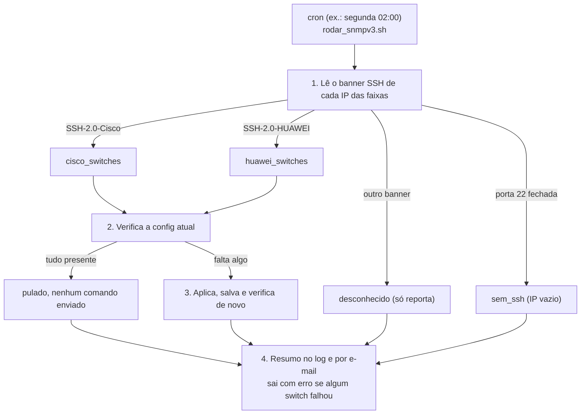

# ansible-snmpv3-switches

[](https://github.com/Thithio/ansible-snmpv3-switches/actions/workflows/ci.yml) 

Automação Ansible que mantém SNMPv3 (`authPriv`) e SNMP trap configurados em switches Cisco e Huawei. Roda agendada: a cada execução, confere cada switch, pula o que já está certo e corrige só o que falta.

Feita para um problema comum em rede de campus: switch trocado chega sem a config de monitoramento e ninguém avisa o time que cuida do Zabbix.

## O que ela faz



- **Fabricante descoberto a cada execução.** O inventário só tem as faixas de IP. O banner SSH decide qual role roda, então trocar um Cisco por um Huawei no mesmo IP não exige editar nada.
- **Verifica antes de aplicar.** Switch conforme não recebe comando nenhum. Sem isso, cada execução mexeria em todos os switches e geraria uma trap de config por switch.
- **Salva a config.** Depois de aplicar, grava na startup-config (Cisco) ou com `save` (Huawei). Config que não é salva some no próximo reboot.
- **IP vazio não é falha.** Quem não responde na porta 22 entra como "sem SSH" no resumo.
- **E-mail no fim de toda execução**, com quantos switches foram configurados, o que faltava em cada um e o motivo de cada falha.

O que é configurado:

| Cisco IOS / IOS-XE | Huawei VRP |
|---|---|
| `snmp-server view SNMP-VIEW iso included` | `snmp-agent mib-view included SNMP-VIEW iso` |
| `snmp-server group MONITORAMENTO v3 priv read ... notify ...` | `snmp-agent group v3 MONITORAMENTO privacy read-view ... notify-view ...` |
| `snmp-server user ZABBIX MONITORAMENTO v3 auth sha ... priv aes 128 ...` | `snmp-agent usm-user v3 ZABBIX` com `sha2-256` / `aes256` |
| `snmp-server host <ip> version 3 priv ZABBIX` | `snmp-agent target-host trap address udp-domain <ip> ... v3 privacy` |
| `snmp-server enable traps snmp linkdown linkup coldstart warmstart` e `config` | `snmp-agent trap enable` |

Os nomes de view, grupo e usuário ficam nos `defaults/` de cada role.

## Estado

- **Cisco:** validada em produção. Na execução de aceite, todos os switches já conformes foram pulados sem receber nenhum comando.
- **Huawei:** a role começa em modo só verificar (`snmpv3_somente_verificar: true`). A sintaxe VRP ainda não foi validada num switch real; teste num equipamento de bancada antes de trocar para `false`.
- O lado do Zabbix (receber as traps no `snmptrapd` e criar itens) fica fora deste repositório.

## Estrutura

```
ansible.cfg
requirements.yml / requirements.txt
inventories/{homolog,production}/
  inventory_switches.ini          faixas de IP (sem fabricante)
  group_vars/cisco_switches.yml   conexão e IP do receptor de trap
  group_vars/huawei_switches.yml
playbooks/
  snmpv3-switches.yml             playbook principal (4 plays)
  vars/secrets.example.yml        modelo dos segredos (cifrar com ansible-vault)
  files/rodar_snmpv3.sh           wrapper do cron: log, lock, limite opcional
  files/enviar_resumo_email.py    e-mail do resumo
roles/snmpv3-cisco/               verificar, avaliar, aplicar e salvar
roles/snmpv3-huawei/
tests/test_avaliar.yml            testa a verificação com saídas simuladas
examples/cron.d-snmpv3-switches
```

## Como usar

1. Dependências no control host:
   ```bash
   ansible-galaxy collection install -r requirements.yml
   pip install -r requirements.txt
   ```
2. Ajuste as faixas em `inventories/production/inventory_switches.ini` e o `zabbix_trap_receiver_ip` nos `group_vars`.
3. Segredos:
   ```bash
   cp playbooks/vars/secrets.example.yml playbooks/vars/secrets.yml
   # preencha usuário/senha SSH e as senhas SNMPv3
   ansible-vault encrypt playbooks/vars/secrets.yml
   echo 'senha-do-vault' > .vault_pass && chmod 600 .vault_pass
   ```
4. Ajuste destinatário, remetente e servidor SMTP no play 4 de `playbooks/snmpv3-switches.yml`.
5. Primeiro em homologação, com um switch de teste:
   ```bash
   playbooks/files/rodar_snmpv3.sh homolog
   ```
6. Depois em produção, à mão e acompanhando. Se der certo, agende com o exemplo de `examples/cron.d-snmpv3-switches`.

Para limitar a um IP: `rodar_snmpv3.sh production 198.51.100.45`.

Para só ver o que falta, sem aplicar nada, use `-e snmpv3_somente_verificar=true`.

## Testes

```bash
ansible-playbook tests/test_avaliar.yml
```

Cobre Cisco conforme, Cisco sem trap e com usuário de nome parecido, Cisco vazio, Huawei conforme e Huawei só com v2c.

## Armadilhas que já custaram tempo

- **`delegate_to: localhost` muda o `ansible_host`.** Na leitura do banner, o IP precisa vir de `hostvars[inventory_hostname]`; senão todos os IPs leem o SSH do próprio control host.
- **Switch antigo e `libssh`.** Switches Cisco legados só negociam algoritmos que a libssh recente recusa. Por isso `ansible_network_cli_ssh_type: paramiko` e `paramiko<3.0`.
- **O usuário SNMPv3 não aparece no running-config do IOS.** A verificação usa `show snmp user`. A senha não dá para conferir, porque o IOS guarda só a chave derivada.
- **`when` em `block` é reavaliado a cada task.** A decisão de aplicar é guardada antes (`snmpv3_precisa_aplicar`), senão a segunda verificação desliga o resto do bloco.

## Licença

MIT
